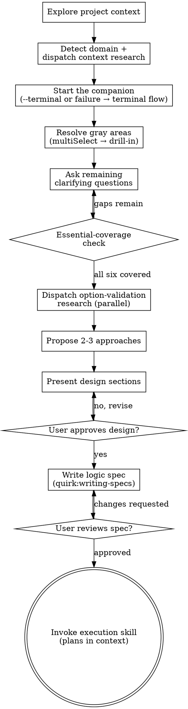

# Brainstorming Ideas Into Designs

Help turn ideas into fully formed designs and specs through natural collaborative dialogue.

Start by understanding the current project context, then ask focused questions — batched, in small groups — to refine the idea. Once you understand what you're building, present the design and get user approval.

A brainstorm is **companion-first**: it runs from kickoff to hand-off inside one browser tab (the visual companion's app mode). The terminal is where the user types the command, where they can still override, and where the skill falls back. See [Start the companion](#start-the-companion).

<HARD-GATE>
Do NOT invoke any implementation skill, write any code, scaffold any project, or take any implementation action until you have presented a design and the user has approved it. This applies to EVERY project regardless of perceived simplicity.
</HARD-GATE>

## Anti-Pattern: "This Is Too Simple To Need A Design"

Every project goes through this process. A todo list, a single-function utility, a config change — all of them. "Simple" projects are where unexamined assumptions cause the most wasted work. The design can be short (a few sentences for truly simple projects), but you MUST present it and get approval.

## Checklist

You MUST create a task for each of these items and complete them in order:

1. **Explore project context** — check files, docs, recent commits
2. **Detect domain + dispatch context research** — classify the work (Visual / API / CLI / Docs / Organization / Data / Integration) and spawn parallel research agents for domain patterns and anti-patterns. See [Research Agents](#research-agents).
3. **Start the companion** — unless the user passed `--terminal`, start the app-mode companion and print its URL; if it can't start, say why once and use the [Terminal flow](#terminal-flow). See [Start the companion](#start-the-companion).
4. **Resolve gray areas** — optionally surface *additional* non-obvious areas via the `adhd` skill first (see [Gray Areas](#gray-areas) → Step 0), then put the standard domain-specific areas — plus any adhd additions — on screen (multi-select), then drill into each selected area with batched clarifying questions.
5. **Ask remaining clarifying questions** — batched on screen (≤4 per step), for anything not covered by gray-area resolution (purpose, constraints, success criteria)
6. **Essential-coverage check** — diff what is established against the six Essential items (see [essential-coverage.md](references/essential-coverage.md)); ask any gaps before proposing approaches. Only past this gate may the user fast-track what remains.
7. **Dispatch option-validation research** (when proposing approaches) — one research agent per candidate option, in parallel
8. **Propose 2-3 approaches** — side by side on screen, with trade-offs, citing research findings, your recommendation
9. **Present design** — one section per screen (short ones may share), get user approval on each before the next
10. **Write logic spec** — follow **quirk:writing-specs**: ask once, on screen, whether to use markdown (the default) or interactive; use [logic-spec.md](../writing-specs/logic-spec.md) for markdown or [interactive-logic-spec.md](../writing-specs/interactive-logic-spec.md) for interactive.
11. **User reviews written spec** — on screen, the rubric's review gate; for an interactive spec, the gate is the page's final (stage-2) sign-off; do not proceed until the user approves
12. **Transition to implementation** — the user picks the execution skill on screen (quirk:subagent-driven-development, recommended; or quirk:executing-plans); invoke it, and it authors a tech spec when warranted (**quirk:writing-specs** → `tech-spec.md`), then plans in context, then executes

## Process Flow



**The terminal state is invoking an execution skill** — quirk:subagent-driven-development (recommended) or quirk:executing-plans — which authors a tech spec when warranted, then plans in context, then executes. Do NOT invoke frontend-design, mcp-builder, or any other implementation skill, and do NOT write a separate plan document first.

## Start the companion

The companion is on by default; `/quirk:brainstorming --terminal add CSV export` opts out. Read [visual-companion.md](visual-companion.md) first: it holds the script path, the step JSON and the loop.

- **Start it at kickoff**, before the context work in steps 1-2, so the tab shows a status line while you read the project. Run `start SESSION --app` with a session directory under `.quirk/brainstorm/`, print the URL in the terminal, and do not open a browser.
- **If it can't run** (`--terminal`, no python3, `start` exits 2, or the user's browser can't reach the port), say why once and run the [Terminal flow](#terminal-flow). `--host` and `--allow-host` are for remote setups, only when the user asks.

Inside a companion brainstorm:

- **The companion replaces orca ask and `AskUserQuestion`.** Your whole voice goes to the chat with `say`, and the terminal stays quiet. Typed terminal input wins: echo it with `say --from user` and update the step.
- **Each wait is a loop.** Send a `step`, run `next` in the background with a long `--timeout`, and act on its events. Set `status` (a plain activity line; `--interruptible` during research) while you work, and refresh `decide` after each answered step.
- **Question batches:** up to ~4 related questions per step, one submit. The recommended option is labeled and first, never preselected. Every choice has an Other box, text-only questions are fine, and a skip is logged as open and re-asked only if something depends on it. A question may carry its own mockup or diagram.
- **Research waits.** On a `continue` event ("Continue without the rest"), stop the outstanding researchers, proceed with what returned, and mark their options "(research pending)" in the spec's Industry Insights.
- **Approaches:** one `approaches` step with 2-3 cards side by side, one recommended, each citing its research.
- **Design:** one `design-section` step per section (short ones may share, up to 3), answered Looks right or Needs changes plus a comment. A revision sets `changed` to highlight the passages and say what changed. The next section follows only after Looks right.
- **Spec:** ask the format as a question on screen. Markdown goes in a `spec-review` step, where Sign off is the review gate's approval and per-section comments get a `reply`. Interactive registers the page with `review`, sends a `spec-review` interactive step, and reads exports from `review-export` events.
- **Edits.** A rail Change or a chat request arrives as an `edit-request`. Send an `edit-card` listing what it invalidates and apply it only on an `edit-decision` confirm, then update `decide`. Never change a decision from chat without that card.
- **Chat and comments.** Answer chat questions with `say` and leave the current step as it is. Answer each comment with `reply` in its thread, and mark it addressed when a revision covers it.
- **Show options, don't just describe them.** When options differ in anything the user could see or feel, every option gets a `preview_html`: a mockup for layouts, densities and states, motion for behavior over time, and an interactive element when the difference is in how it feels to use. Use the writing-html-artifacts kit (`q-flow`, `q-schema`, `q-sequence`, `q-chart`, Mermaid `diagram` for state charts) wherever a picture explains the structure better. Text-only options are for choices with nothing to see, such as a policy or a default. [visual-companion.md](visual-companion.md#showing-options) has the mechanics.
- **Hand-off.** A `hand-off` step picks the execution skill, then a `done` step follows. If the pick is quirk:subagent-driven-development, the `done` message is "Starting SDD in this tab", do not run `stop`, and hand SDD the session path. Any other pick keeps done, then `stop` the companion.

## Research Agents

Brainstorming uses parallel **research-agent swarms** (via the `Agent` tool — Claude Code's subagent-dispatch tool, named `Task` in older builds) to ground design decisions in current external knowledge — best practices, anti-patterns, post-mortems, and real-world experience reports — instead of leaning purely on training data.

### Agent Types

| Agent | Model | Purpose | Sources/agent |
|-------|-------|---------|---------------|
| `web-research-agent` | haiku | Fast parallel searches; pattern + anti-pattern validation | ~3 |
| `deep-research-agent` | sonnet | Multi-round investigation of the chosen approach (depth=2) | ~5–7 |

### Research Phases

Spawn agents in **a single message** per phase (parallel execution is mandatory — sequential same-phase agents are a defect):

**Get current year first** (used in every prompt to avoid stale results):
```bash
date +%Y
```

**Phase A — Context research (Checklist step 2)** — 2 parallel `web-research-agent`:
- Agent 1: `"[domain from task] simple architecture patterns minimalist implementation [YEAR]"`
- Agent 2: `"[domain/technology] common pitfalls anti-patterns lessons learned post-mortems [YEAR]"`

**Phase B — Option-validation research (Checklist step 7)** — 1 `web-research-agent` per candidate option (typically 3 total, in parallel):
- Per option: `"[option approach name] real world experience pros cons [YEAR]"`

**Phase C (optional) — Deep validation of the chosen approach** — 1 `deep-research-agent` (sonnet, depth=2), only when the chosen approach is novel, high-stakes, or production-bound:
- `"Investigate [chosen approach] for [domain]: implementation best practices, testing strategies, common mistakes, edge cases. Focus on [YEAR] production lessons."`

### When to Skip Research

- **Truly trivial work** (config tweak, single-function utility, obvious one-liner): skip the swarm; the design itself can still be a few sentences.
- **Domain you've already researched in this session**: reuse prior findings; do not re-spawn.
- **No dispatch tool at all / offline**: continue in offline mode; add a "(research pending)" note in the spec's Industry Insights section. A dispatch tool under a different name is not this case — see Fallback Modes.

### Result Integration

From each agent response, extract: **Key Findings** (distilled bullets that change a decision) and **Sources** (URLs/refs for traceability). Feed these into:
- **Candidate questions** — every finding implying a decision becomes a *candidate question*. The altitude test filters it; the Essential tier only classifies the survivors. A survivor that belongs to a selected gray area is asked in that area's drill-in; every other survivor goes into the remaining-questions batch. Research raises question *quality*, never question *count*.
- The option proposals (cite findings in pros/cons)
- The logic spec's "Industry Insights" section

### Fallback Modes

- **A differently-named dispatch tool is still the dispatch tool.** The subagent-dispatch tool is `Agent` in current Claude Code, was `Task` in older builds, and is `task` / `spawn_agent` on other platforms (`skills/using-quirk/references/`). Whatever it is called in your session, use it. A name that does not match this document is never a reason to skip research.
- **Total failure** (dispatch attempted and it failed — every agent errored out or returned nothing): proceed offline; mark spec sections "(offline mode — validation pending)". Only an attempted-and-failed dispatch qualifies; not finding a tool named `Agent` does not.
- **Partial failure** (some agents fail): proceed with what returned; note which phase lacks coverage.
- **Deep-research fails**: substitute with 2 parallel `web-research-agent` calls.

## Gray Areas

A **gray area** is a domain-specific decision space where the request is ambiguous and multiple defensible answers exist. Resolving gray areas up front — in batched, multi-select form — is faster and clearer than discovering them mid-design.

### Domain Detection

Classify the work from the task description before clarifying questions:

| Domain | Signals |
|--------|---------|
| Visual | "display", "show", "UI", "page", "component", "feed", "dashboard" |
| API | "API", "endpoint", "REST", "GraphQL", "request", "response" |
| CLI | "CLI", "command", "terminal", "script", "tool" |
| Docs | "docs", "documentation", "guide", "README", "tutorial" |
| Organization | "organize", "structure", "migrate", "refactor", "clean up" |
| Data | "import", "export", "ETL", "pipeline", "transform", "process" |
| Integration | "integrate", "sync", "connect", "webhook", "third-party" |

### Expected Gray-Area Catalog

Use these as the seed set for the multi-select question. Pick the 3–4 most relevant for the specific request. This is the **standard set** — it is chosen the same way whether or not adhd runs, and adhd never removes or rewrites an entry in it.

- **Visual**: layout-style, information-density, loading-pattern, empty-state, error-state, interaction-style
- **API**: response-format, error-responses, authentication, versioning, rate-limiting, pagination
- **CLI**: output-format, flag-design, progress-reporting, error-recovery, exit-codes
- **Docs**: structure, tone, examples-depth, versioning, search-discovery
- **Organization**: grouping-criteria, naming-convention, duplicate-handling, exception-handling
- **Data**: input-format, output-format, error-handling, performance-mode, idempotency
- **Integration**: sync-direction, conflict-resolution, retry-policy, data-mapping, auth-method

Two entries name their *observable* reading: `performance-mode` is the mode the user selects, not an
internal optimization strategy; `data-mapping` is the visible field contract, not the transform.

### Question Altitude

Brainstorming asks about **observable outcomes**. Implementation belongs to the tech spec. Apply this
to every design question before asking it — not to the skill's own process prompts (the adhd offer,
the gray-area pick):

> **Would the answer change what the consumer observes, or only how it is built?**

Observable → ask it here. Build-only → do not.

**"Observable" is relative to this thing's consumer.** For a UI the consumer is a person, so storage
engines and file layout are out of bounds. For an API or CLI the consumer is a developer, so response
shape, flag design, and exit codes *are* the observable surface. Key on consequence to the consumer,
never on whether a topic sounds technical.

**The one escape:** ask an implementation question when that choice
*is itself the user-facing decision* — the same exception that lets a design name file structure.

**When altitude is unclear,** try to *reframe the question in terms of what the consumer observes*.
Ask the reframed version if it survives; if it cannot be reframed observably, it is build-only.

**Build-only questions are routed, not dropped.** Capture each in the **Deferred Ideas** list tagged
`[tech-spec]`, so the tech spec inherits the open question instead of rediscovering it cold.

### Step 0 — Offer adhd divergent discovery (optional)

Before surfacing gray areas, offer to run the `adhd` skill to find **non-obvious** decision areas the static catalog would miss. The catalog is the cheap baseline; adhd is the opt-in, higher-cost expansion.

adhd is **purely additive**: it appends extra candidate areas on top of the standard set. It never drops, replaces, reorders, or reworks a catalog area — running it can only ever grow the set of areas the user chooses from.

**Skip this offer entirely on truly trivial work** (for example: a config tweak or an obvious one-line utility). This is narrower than the research-swarm skip rule — do **not** suppress the offer just because you've already researched the domain in-session. Otherwise the offer is the first question of the first batch, next to the gray-area pick from Step 1. Its header is "Find gray areas", with two options: "Use the standard set (Recommended)" (catalog areas only, no extra cost) and "Add adhd areas" (5–10× cost, extra non-obvious areas on top of the standard set, which stays intact). The question reads: "Before we pick what to clarify — want me to run adhd to surface non-obvious decision areas specific to this request? (~5–10× cost, parallel divergent ideation)". The [Terminal flow](#terminal-flow) shows the exact shape.

- **Recommended = the cheap path**, so the default is a one-click "no."
- If the user picks **"Add adhd areas"**: invoke the `adhd` skill with a **discovery-framed** delegation — the decision point you hand adhd is *"what latent ambiguous decisions are in this request?"*, so its returned "options" are candidate gray areas (not solutions). adhd's frames (failure pre-mortem, stakeholder rotation, expert blind spots) are blind-spot finders well-suited to this.
- **Dedupe, then append.** Drop any returned area that restates a catalog area already in the standard set (same decision under a different name); keep the catalog wording for those. Carry the remaining 2–4 forward as their own question (in the next batch on screen), prefixing each label with `adhd:` (e.g. `adhd: offline-degradation`) so the user sees which areas came from divergent ideation.
- If the user picks **"Use the standard set (Recommended)"**: proceed with catalog areas only — identical to the no-adhd flow.

### Step 1 — Surface gray areas (multi-select)

Send a `multi` question. Each option is a domain-specific area with a description that explains *why* it's ambiguous: 3–4 standard-set areas, verbatim. The adhd areas, when adhd ran, go in their own question ("adhd also surfaced these less-obvious areas — clarify any of them too?", header "adhd areas", arriving in the next batch on screen), never appended to the standard list, so the standard question is unchanged. A question holds at most 4 options, which is the other reason they need their own. Selecting nothing in the adhd question is a valid answer — the standard areas still proceed to drill-in.

Two cases need a different shape:

- **Exactly one adhd area survives.** Do *not* pad a multi-select list with "None of these" — the user could check it *and* the area, which is contradictory. Make it a `single` question with two mutually exclusive options: `adhd: [area name]` and "Skip it".
- **No adhd area survives.** Send the standard question alone and say in the chat that adhd found nothing beyond the catalog.

Drill-in (Step 2) treats selections from both questions identically — one area at a time, in the order they were presented.

### Step 2 — Drill-in per selected area (3–7 questions, batched)

For each selected gray area, generate 3–7 focused questions that progress from **foundational** (core behavior) to **edge-case** (errors, empties, limits) — screened candidate questions that belong to the area first, then your own. Send up to 4 questions per `questions` step (2 steps if an area needs 5–7).

Per-question rules:
- `single` choice per question
- 2–4 concrete options, with the **recommended option first** and `(Recommended)` appended to its label (on screen, set `recommended` and the shell adds the tag)
- `description` ≥ 1 sentence explaining implications and trade-offs
- `header` is a short category label (e.g., "Layout", "Auth", "Errors")
- **Order by forking power**: ask first whatever answer eliminates the most downstream options, then progress foundational → edge-case
- Process **one area at a time** — don't interleave; show a mini-recap of locked decisions after each area before moving on.

Example — Visual / "Layout style" (5 questions):
1. Primary layout pattern? (cards / list / grid)
2. Responsive behavior? (stack / hide columns / scroll)
3. Information density? (compact / comfortable / spacious)
4. Content priority in each item? (title-first / media-first / action-first)
5. Empty state? (illustration / CTA / placeholder skeleton)

### Checkpoint Rules (apply to all gray-area questions)

- **No delegation options**: never offer "You decide", "Whatever you think". If the user says "you decide", pick the recommended option, explain why, and confirm on screen.
- **Concrete labels**: name options by what they ARE ("Card layout", "JSON responses") — not "Option A".
- **Recommended option first**, with `(Recommended)` appended.
- **Delegation vs election**: the skill **may never offer to decide** — no "You decide" option, ever. But the user may always **elect to accept stated defaults** ("go with your recommendations"). That is their call, not an option you offered; log each resulting decision as `assumed — fast-tracked`. **Scope decides which rule fires:** "you decide" on *one* question takes the confirm path above; "go with your recommendations" for *everything remaining* is the fast-track, legal only once the six are covered. See [essential-coverage.md](references/essential-coverage.md).

### Scope Creep Guard (active during gray-area drill-in)

Watch for "also add", "we should also", "what about adding", "could we also", "it would be nice if". When detected:
1. Capture the idea in a running **Deferred Ideas** list (carried into the logic spec).
2. Acknowledge briefly: "Good idea — captured as a deferred item so we don't lose it. Let's stay focused on [current area]."
3. Return to the current question without absorbing the new scope.

## The Process

**Understanding the idea:**

- Check out the current project state first (files, docs, recent commits)
- Before asking detailed questions, assess scope: if the request describes multiple independent subsystems (e.g., "build a platform with chat, file storage, billing, and analytics"), flag this immediately. Don't spend questions refining details of a project that needs to be decomposed first.
- If the project is too large for a single spec, help the user decompose into sub-projects: what are the independent pieces, how do they relate, what order should they be built? Then brainstorm the first sub-project through the normal design flow. Each sub-project gets its own spec → plan → implementation cycle.
- Classify the domain (Visual / API / CLI / Docs / Organization / Data / Integration). Dispatch the **Phase A research swarm** in parallel (see [Research Agents](#research-agents)) so findings are ready by the time you ask clarifying questions. Skip the swarm only if the work is truly trivial or you've already researched this domain in-session.
- After research returns and the companion has started, run the **gray-areas resolution** (see [Gray Areas](#gray-areas)) to batch-resolve domain ambiguity before the remaining questions.
- Then ask any remaining clarifying questions — including screened candidates that belong to no selected area — batched on screen (≤4 per step) and ordered most-forking-first, as in the drill-in
- Prefer multiple choice questions when possible, but open-ended is fine too
- Keep batches small — about four per step; split a topic needing more into a second step
- Focus on understanding: purpose, constraints, success criteria

**Exploring approaches:**

- Before proposing approaches, dispatch the **Phase B option-validation research swarm** (one `web-research-agent` per candidate option, in parallel) so each option's pros/cons cite real-world findings.
- Propose 2-3 different approaches with trade-offs
- Show them as one `approaches` step with your recommendation and reasoning, citing relevant research findings (sources can be linked in the spec's Industry Insights section)
- Lead with your recommended option and explain why
- For novel, high-stakes, or production-bound work, run **Phase C deep-research** on the chosen approach before writing the logic spec

**Presenting the design:**

- Once you believe you understand what you're building, present the design
- Scale each section to its complexity: a few sentences if straightforward, up to 200-300 words if nuanced
- Ask after each section whether it looks right so far (Looks right or Needs changes, on screen)
- Cover: conceptual model, data flow (prose), key decisions & rationale, behavior & scenarios, scope & non-goals, glossary. **quirk:writing-specs** owns the line between what belongs here and what belongs in the tech spec authored later at execution
- Be ready to go back and clarify if something doesn't make sense

**Design for isolation and clarity:**

- Break the system into smaller units that each have one clear purpose, communicate through well-defined interfaces, and can be understood and tested independently
- For each unit, you should be able to answer: what does it do, how do you use it, and what does it depend on?
- Can someone understand what a unit does without reading its internals? Can you change the internals without breaking consumers? If not, the boundaries need work.
- Smaller, well-bounded units are also easier for you to work with - you reason better about code you can hold in context at once, and your edits are more reliable when files are focused. When a file grows large, that's often a signal that it's doing too much.

**Working in existing codebases:**

- Explore the current structure before proposing changes. Follow existing patterns.
- Where existing code has problems that affect the work (e.g., a file that's grown too large, unclear boundaries, tangled responsibilities), include targeted improvements as part of the design - the way a good developer improves code they're working in.
- Don't propose unrelated refactoring. Stay focused on what serves the current goal.

## After the Design

**Documentation, self-review, and the user review gate:**

Follow **quirk:writing-specs** — its [logic-spec.md](../writing-specs/logic-spec.md) rubric owns where markdown `logic.md` is written, the sections it must contain (including *Decisions Locked*, *Industry Insights*, and *Deferred Ideas*, which you have been accumulating throughout this session), the inline self-review, the user review gate, and the `Tech spec: requested` capture.

When the user chose interactive, [interactive-logic-spec.md](../writing-specs/interactive-logic-spec.md) owns the `logic.json` and page sign-off workflow. Do not restate those rules here.

Do not proceed past the rubric's user review gate until the user approves.

**Implementation:**

- Send a `hand-off` step so the user picks the execution skill, then invoke it — quirk:subagent-driven-development (recommended) or quirk:executing-plans. For SDD, send `done` ("Starting SDD in this tab"), skip `stop` and pass the session path; for executing-plans, `done` then `stop`. It authors a tech spec when warranted, then plans in context, then executes.
- Do NOT invoke any other implementation skill, and do NOT write a separate plan document first.

## Key Principles

- **Batch questions, don't drip them** — up to 4 per screen, one *area* at a time. A batch lets the user see how the questions relate to each other; dripping them serially hides it.
- **Multiple choice preferred** - Easier to answer than open-ended when possible
- **Research in parallel, never sequentially** - Same-phase agents ship in a single message
- **Resolve gray areas before open dialogue** - Multi-select up front, drill into each selected area, then batch the remaining open questions
- **YAGNI ruthlessly** - Remove unnecessary features from all designs
- **Explore alternatives** - Always propose 2-3 approaches before settling
- **Incremental validation** - Present design, get approval before moving on
- **Be flexible** - Go back and clarify when something doesn't make sense

## Terminal flow

The shape used by `--terminal` and the fallback. Everything above applies, except that questions go through `orca ask` when it is available (see the `orca-ask` skill) and otherwise `AskUserQuestion`, up to 4 per call, one area at a time. There is no companion, so approaches, design sections and the spec review are conversational and the execution pick is a question. The labels are the same ones used on screen.

The adhd offer, its own call (skipped on truly trivial work):

```
AskUserQuestion:
  questions:
    - question: "Before we pick what to clarify — want me to run adhd to surface non-obvious decision areas specific to this request? (~5–10× cost, parallel divergent ideation)"
      header: "Find gray areas"
      multiSelect: false
      options:
        - label: "Use the standard set (Recommended)"
          description: "Surface gray areas from the domain catalog only. No extra cost."
        - label: "Add adhd areas"
          description: "Spend 5–10× to surface non-obvious ambiguities the catalog misses; they're added on top of the standard set, which stays intact."
```

The gray-area pick. When adhd ran, send both questions in the **same call**, because a question holds at most 4 options:

```
AskUserQuestion:
  questions:
    - question: "Which of these areas should we clarify before designing?"
      header: "Gray areas"
      multiSelect: true
      options:
        - label: "[Area name]"
          description: "[Why this area matters and what's ambiguous about it]"
        # ... 3–4 standard-set areas total
    - question: "adhd also surfaced these less-obvious areas — clarify any of them too?"
      header: "adhd areas"
      multiSelect: true
      options:
        - label: "adhd: [area name]"
          description: "[Why this area matters and what's ambiguous about it]"
        # ... 2–4 total
```

For exactly one surviving adhd area, make that question `multiSelect: false` with `adhd: [area name]` and "Skip it". Drill-in questions use `multiSelect: false`, 2–4 options, and the recommended option first.
