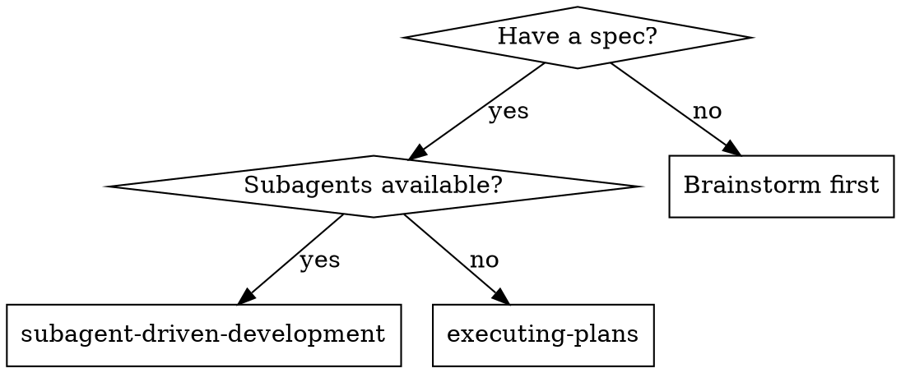
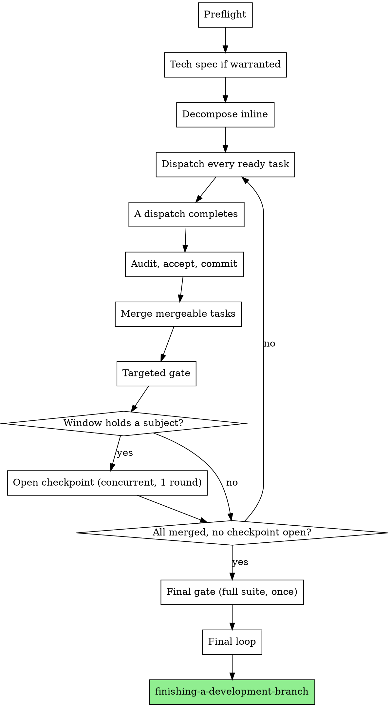

# Subagent-Driven Development

Execute a plan with **cheap, fast implementers and one adversarial review loop at the end**.
Implementation is disposable and parallel; judgment is concentrated where it can see the whole
branch.

**Core principle:** quality lives at the branch level, not per task. A defect can survive in the
tree until the review loop finds it — that is the deliberate trade for implementation speed, and
it is why the loop and its gates are not optional.

## When to Use



`quirk:executing-plans` is the **sequential, same-session, no-subagents** path. Use it when
subagent dispatch is unavailable, or when this skill is itself the thing being edited. Unavailable
means a dispatch was attempted and failed, or the platform has no subagents at all (Gemini CLI) —
not that the dispatch tool goes by a name this document does not use. It is `Agent` in current
Claude Code, was `Task` in older builds, and is `task` / `spawn_agent` elsewhere; whichever your
session has is the one to use.

## Roles

| Role | Model | Effort | Job |
| --- | --- | --- | --- |
| Orchestrator | the session model | session setting | Decompose, dispatch, audit, commit, adjudicate, route |
| Implementer | Claude subagent via `Agent`, or pi codex via `pi-watch` — chosen once at preflight (`IMPLEMENTER`) | `high` | Build one task |
| Promote reviewer (stage 1) | the recorded `REVIEWER_ALIAS` via `quirk:adversarial-review` | `high`, capped by `model.json` thinking ceiling on `pi-watch` | Review through one lens |
| Refute reviewer (stage 2) | fresh context via `quirk:adversarial-review` | `high`, capped by `model.json` thinking ceiling on `pi-watch` | Attack the promoted claims |
| Fixer | the same binding as Implementer — inherits `IMPLEMENTER`, not the reviewer's family | `high` | Apply an adjudicated finding packet |
| Tiebreak arbiter (stage 3) | a third family via `quirk:adversarial-review` | `medium` | Settle contested claims |
| Explore / codebase survey | a survey subagent | `low` or `medium` | Locate implementation context |

You are the only agent that persists. Every worker is fresh, gets exactly what it needs, and
returns once. Reviewers are a different model family from implementers on purpose — a model
reviewing another family's output catches more than one reviewing its own idioms. A deliberate
same-family pick is allowed, not forbidden: it degrades independence rather than blocking the run,
and preflight labels it so the choice is visible rather than accidental.

## The Process



A task dispatches as soon as its own dependencies have merged, and a checkpoint holds back only the
merges of tasks that build on what it is reviewing. Step 4 owns the scheduling rules.

### Step 1: Preflight

Run git checks and backend/environment probes **before prompting the user**:

```bash
git rev-parse --abbrev-ref HEAD
git status --porcelain
```

In a temporary scratch directory outside the repository, run `pi-watch --check <alias>` across
all six aliases (`codex, gemini, terra, opus, sonnet, flash`). Probe test-runner availability
(not the full suite), and record the exact build and `FULL_SUITE_CMD` commands plus Step 7's
selection inputs: `TARGETED_TEST_CMD` (the runner invocation that takes test-file arguments, such as
`python3 -m pytest -q`), `TEST_FILE_GLOB` (the runner's test-file pattern), and `COMPONENT_CHECKS`
(a path prefix mapped to the exact non-test-runner checks that component needs, such as pnpm builds
and browser e2e, read from the repo's own scripts and config). Never offer an unverified backend
pair; no probe should dirty the repository.

Present a **single consolidated Tier 1 preflight card** via `orca ask`, using `AskUserQuestion`
when `orca ask` returns `status: "unavailable"` or is not installed (see Failure routing).
The card contains these questions, with the conditional ones included in that same card:

- `backend_pairing`: single select over pre-verified `(IMPLEMENTER, REVIEWER_ALIAS)` pairs.
  List cross-family full-independence pairs first: `claude-task + codex (Recommended)`,
  `claude-task + gemini`, `claude-task + terra`, `pi-codex + opus`, `pi-codex + gemini`.
  Offer only reachable pairs; `pi-codex` additionally requires the successful `codex` probe.
  Follow with reachable same-family pairs, such as `claude-task + opus`, `claude-task + sonnet`,
  or `pi-codex + codex`, each labeled `(reduced independence)`. Warn once for that degradation.
  If no reviewer alias resolves, preserve the `Agent` path: warn once and record
  `REVIEWER_ALIAS = "task-fallback"` instead of an unreachable alias.
- `dirty_tree_action`: include when `git status --porcelain` is non-empty. Choose
  `stash_untracked` (`git stash push --include-untracked`), `commit_existing` (commit the existing
  work), or `abort` (stop the run). Perform the chosen action and verify `git status --porcelain`
  is empty **before** recording `RUN_BASE`; never begin dispatch with inherited dirt.
- `env_readiness`: include when no test runner is discovered or a preflight probe fails. Ask how
  to run checks, or abort; resolve and verify the supplied command before dispatch.

Starting on main/master still requires explicit consent; include that required decision in the
card when applicable. Derive `AUTHOR_FAMILY` mechanically from the selected implementer:
`claude-task → anthropic`, `pi-codex → openai`. Record `IMPLEMENTER`, `AUTHOR_FAMILY`, and
`REVIEWER_ALIAS` once; they are immutable for the run. Then record `git rev-parse HEAD` as
`RUN_BASE`, after the clean-tree check. Never silently swap a backend later.

Open the **run journal** in scratch, outside the repository (a worker with edit tools could
otherwise commit or clobber it). It holds `RUN_BASE`, the backend record (`IMPLEMENTER`,
`AUTHOR_FAMILY`, `REVIEWER_ALIAS`), `WIDTH_CAP` and `CHECKPOINT_CAP`, ordering-edge
reclassifications, the projected schedule shape, reviewer outputs, findings with IDs and rulings,
dismissals, `tree_test_cache`, and `ROUND_<r>_HEAD` / `LAST_ROUND_HEAD`. Scheduling goes into an
**append-only event log**, one timestamped line per event, so the run can be replayed to show what
ran when and on which commit:

- `dispatch` / `return`: task or fixer ID, attempt, `TASK_BASE_<n>`, `TASK_HEAD_<n>`, status word
- `accept` / `commit`: `WORKTREE_TREE_<n>`, `TASK_COMMIT_<n>`
- `merge`: task ID and the new `INTEGRATION_HEAD`
- `gate`: `GATE_BASE_<g>` (or `FIX_BASE`), the tasks or packets it covers, its `GATE_CMDS`, any
  `unguarded` paths, green or red, and the new `GREEN_HEAD` when green; the final gate's
  `FINAL_GATE_CMDS` and any `selection miss`
- `checkpoint-open` / `checkpoint-close`: `CHECKPOINT_BASE_<k>`, `CHECKPOINT_HEAD_<k>`, covered
  tasks, held dependents, fix commits
- `hold`, `rework`, `merge-as-is`, `supersede`, `stop`: task ID and one-line reason
- `cap-bind`, `lock-wait`, `checkpoint-cap`: which ready task or window waited, and on what

### Step 2: Tech spec, only when warranted

Apply the complexity-tier gate: author one if execution spans more than one session, crosses a
subsystem boundary, touches ≳3 source files, or the user asked. Otherwise skip. Record the ruling
in one line either way — a silent skip is how this gate decays into never firing.

If the gate fires, use **quirk:writing-specs** (its `tech-spec.md` rubric). If a reviewed `tech.md` already exists beside
the logic spec, load it rather than re-authoring.

### Step 3: Decompose inline

Run **quirk:writing-plans** as the in-context planning rubric, then break the spec into tasks **in
this conversation and into TodoWrite**. Do not write a plan file unless the user asks or it must
outlive the session. Running the full rubric brings its Granularity Economics, vertical-slice
partitioning, and hub-file heuristic into this control plane rather than borrowing its field schema
alone.

Each task carries: a **contract**, **acceptance commands** (literal and copy-runnable, exact flags),
optional `dependencies`, and `scope.files` — **required on every task**, parallel or not. Step 6
audits every task's changes against it and the implementer prompt hands it to the worker as a hard
boundary, so a task without one leaves the audit with nothing to audit against and the worker with
no scope contract.

**Do not dispatch the plan-document reviewer, even after invoking `quirk:writing-plans` as the
rubric.** This carve-out survives rubric invocation. That prompt describes its own dispatch as "the
standard gate, not optional" — that wording governs plans built *by* `writing-plans` as a
standalone workflow, not this skill's inline decomposition. The reason it is skipped here: this
control plane spends its review budget on the branch, where a reviewer reads the code that exists,
rather than at plan time, where it reads a prediction of it. A decomposition defect surfaces
mechanically anyway — through the scope audit, the build/test gate, or the final loop — so the round
costs more than it returns. Skipping it is a decision already made, not an oversight for you to
correct — and "this plan is unusually high-stakes" is not new information, because every run
believes that.

When the logic spec has a Screens section, the signed-off mock it links is the UX source of truth
wherever the text is silent. Each UI task cites the mock screens it implements and carries the
Screens acceptance items for them in its acceptance. The implementation is rebuilt in the project's
stack and never lifts mock code. A deliberate departure from the mock needs a one-line note in the
tech spec or the PR, or the acceptance item fails.

Before scheduling, audit every declared `dependencies` edge for semantic motivation: keep it as a
**dependency edge** only when the target genuinely needs the source's output. An edge motivated
only by file overlap becomes an **ordering edge**. It still keeps the target from dispatching
until the source merges, because the two share a file and the plan said which goes first. It does
not hold the target's merge behind the source's checkpoint, and no checkpoint fix to the source
triggers the target's rework (Step 4), because the target consumes none of the source's behavior.
Reclassify the edge rather than deleting it: the scope lock would still keep the pair apart, but
without the edge it could run them in the opposite order. Journal every reclassification.

Then check the graph of dependency and ordering edges for a cycle. A cycle is a plan defect: stop
before dispatch and report it. Do not drop an edge to force an order — which edge goes decides
which task's output the other one misses, and that choice belongs to the plan author.

### Step 4: Schedule

There are no waves and no barriers. The scheduler is a loop over the run's state: a task dispatches
the moment its own inputs exist, and nothing waits on a task unless it has to.

#### State, locks, and readiness

Each task is `pending`, `running`, `accepted` (audited, accepted, and committed on its own branch by
Step 6), `merged`, `superseded`, or `stopped`. `GREEN_HEAD` is the newest integration commit whose
targeted gate (Step 7) passed, and it starts at `RUN_BASE`. Every dispatch forks from it.

A task holds a **scope lock** on its `scope.files` from dispatch until its merge is inside
`GREEN_HEAD`, or until it is superseded or stopped and its branch discarded. A fixer holds one on its
write scope the same way. Holding the lock until the merge is green, not just until the worker
exits, is what makes every merge conflict-free: any task merged after another forked was either
locked at that fork or dispatched behind that task's own lock.

A pending task is **ready** when every dependency and ordering predecessor is merged into
`GREEN_HEAD` and its `scope.files` are disjoint from every held lock. Readiness ignores checkpoints:
a task whose dependency is under review dispatches anyway, and the checkpoint holds its merge
instead (below).

The lock is how the invariant **no two concurrent tasks share a file** is enforced. There is no
"small overlap" exemption. Two agents editing one file in separate worktrees collide at merge, and
both outcomes cost more than serializing would have. Overlapping hunks conflict, which stops the
run for a re-plan. Disjoint hunks are worse: git combines them cleanly into a version **neither
agent wrote or tested** — each one's acceptance passed against its own copy of the file, and nothing
re-checks the combination until a gate, where you meet it as a symptom rather than a cause.
Distance within the file does not make overlap safe; it only decides which of the two failures you
get. A shared path serializes only the tasks that share it, never the rest of the run.

A fixer never waits on a task's lock: a held task releases its lock only after its checkpoint
closes, and the checkpoint cannot close before its fixer merges, so the wait could deadlock. Any running or accepted task whose lock intersects a
fixer's write scope is superseded (see the rework rule). A fixer does wait on another fixer's lock,
except a fixer for a red gate, which supersedes whatever it intersects and is the only change that
may merge onto a red tip.

#### Priority and the width cap

When more tasks are ready than there are slots, or two ready tasks share a file, dispatch first the
task with the longest downstream path (the most tasks on any chain of dependency or ordering edges
leading out of it), then the lower plan task order. The longest path sets the run's makespan, and
the fixed tie-break makes the same plan schedule the same way on every run.

Record `WIDTH_CAP`, a soft cap of roughly 4–6 concurrent implementer and fixer dispatches. It bounds
unsandboxed model processes, not worktrees or branches. An accepted task waiting to merge holds a
lock and a branch but no slot, so a long checkpoint never starves the cap. Journal a `cap-bind`
event whenever a ready task waits for a slot, so a throttled run is not misreported as a naturally
narrow one.

#### The scheduling pass

Run this pass whenever a dispatch completes and whenever a checkpoint's lenses return or its fixes
merge:

1. Run Step 6's audit, acceptance, and commit for every returned task and fixer.
2. If the integration tip is `GREEN_HEAD`, merge every mergeable accepted task, one at a time, in
   priority order (Step 6). A task is **mergeable** when each of its dependencies has been covered
   by a checkpoint that has closed or was skipped, and every rework ruling recorded for it says
   merge as-is. A dependency is always a subject, so a merge never skips its review.
3. Run the merge gate (Step 7) once over this pass's merges, with `GATE_BASE_<g>` the tip before
   the first of them. The gate runs in the foreground of the pass; it is targeted, so this costs
   seconds to minutes, and running workers are unaffected. Green advances `GREEN_HEAD` to the tip.
   Red leaves `GREEN_HEAD` where it was.
   Nothing merges onto the red tip until a fix makes it green, and new dispatches keep forking from
   the last green head, so work that does not depend on the red merges carries on.
4. Open a checkpoint if the window since the last one now contains a subject (below).
5. Dispatch every ready task, in priority order, up to `WIDTH_CAP`.

A checkpoint does not wait for the full suite. It waits for nothing but the targeted gates of the
merges it covers, and those already passed in step 3 of the pass that opened it.

When every task is merged into `GREEN_HEAD` and no checkpoint is open, the run takes Step 7's
final gate and then the final loop. If nothing is running, nothing is ready, no checkpoint is open, and tasks remain, a stopped
task is blocking its dependents: surface it.

#### Checkpoints

A checkpoint exists to reduce the chance of building on a defect. Only a task that something builds
on can cause that, so only those tasks open one.

- **Subject.** A task with at least one dependent through a dependency edge. A task with nothing
  downstream, or only ordering successors, is never a subject. It never opens a checkpoint and never
  holds anything back; the final loop reviews it.
- **Window.** Checkpoint `k` covers `CHECKPOINT_BASE_<k>..CHECKPOINT_HEAD_<k>`: from the previous
  checkpoint's head (`RUN_BASE` for the first) to `GREEN_HEAD` when it opens. It covers every task
  merged in that range, subjects or not, plus any fix merged there by an earlier checkpoint. A fix
  never makes a window a subject on its own: a fix merged after the last subject is reviewed by
  the final loop.
- **Opening.** Open checkpoint `k` in the pass whose gate made the window contain a subject, as long
  as fewer than `CHECKPOINT_CAP` (default 2) checkpoints are open. Otherwise the window keeps
  growing until one closes. Each open checkpoint gets its own `$WORK` directory for Step 8, seeded
  with the gate record (`gate-check.json`) for `CHECKPOINT_HEAD_<k>`.
- **Holds.** A checkpoint holds the *merge*, never the dispatch, of every dependency-edge dependent of
  the tasks it covers. Nothing else is held: leaves, unrelated tasks, and ordering successors run
  and merge on their own schedule.
- **Closing.** Run Step 8's one checkpoint round and Step 9's adjudication and fixers, then merge
  each fix through Step 6 with a green fix-batch gate (Step 7). Record a rework ruling for every held dependent
  that is running or accepted, then close the checkpoint.

**Rework rule.** A held dependent is **superseded** when a fix in the closing checkpoint changed
something it builds on:

- the fix diff touches a path in the dependent's `scope.files`, or
- the fix changes a contract that the dependent's task text excerpts or calls: a signature, a
  request or response field, a status code, an error enum, an event shape. For example, a fix that
  makes a draft body carry the step id, or makes a draft for a non-current step return 409,
  supersedes every held dependent that sends drafts.

Otherwise the ruling is **merge as-is**: the dependent merges onto a tip that includes the fix, and
that merge's targeted gate checks the combination. Journal each ruling with its reason.

Rule as early as you can. When adjudication accepts a finding, its fixer's write scope and any
contract change are already known, so supersede the affected dependents then rather than at close;
that releases their locks while the fixer works. At close, re-check the remaining held dependents
against the actual fix diff. A dependent held by several checkpoints gets a ruling from each, and
any supersede ruling wins.

A superseded dependent is discarded, not patched. A running one finishes first and still gets its
HEAD-check and scope audit, which keeps the signal about a misbehaving worker; then its worktree and
branch go. An accepted one's branch goes at once. Either way it returns to `pending` carrying the
revised contract excerpt, which the fix batch must also update in the plan and in `tech.md`. It is
not ready again until the checkpoint that superseded it has closed, and it then redispatches from
the new `GREEN_HEAD`. A redispatch after supersession is a fresh attempt, not the
task's one retry. Dependents that had not dispatched when the checkpoint closed need no ruling: they
fork from a head that already holds the fix.

**Why dependents proceed, but only one level deep.** Making dependents wait for review puts the
whole review latency on every dependency edge, so the run idles exactly as it would behind a
level-by-level barrier. Letting them merge unreviewed lets a contract change land in merged code
and cascade through everything built on top of it. Holding only the merge gets the overlap without the cascade. The dependent builds
while its dependency is reviewed, and because it cannot merge, nothing downstream of it has started.
A contract change therefore costs at most one re-implementation of the held tasks that consume it,
and never a patch to merged code. The price is that a dependent's own dependents start only once the
checkpoint covering its dependencies closes, so each dependency level costs the longer of build time
and review time instead of their sum.

You may skip a checkpoint for a genuinely trivial window; record a reason naming why. A skipped
checkpoint closes at once, and every ruling it would have made is merge as-is.

#### Shape preview

Before the first dispatch, report and journal the projected shape: task count, dependency and
ordering edges, the initial ready set, the critical path (the longest chain of edges, in tasks), the
subjects that will open checkpoints, the leaves that never block anything, the peak width the graph
allows against `WIDTH_CAP`, and the binding.

If the plan projects as a pure chain with depth N and width 1, surface that shape once and name the
dependency edges forcing it. Do not auto-re-decompose it; the user may know that the semantic
ordering is genuine, and guessing otherwise would override the plan's contract.

### Step 5: Dispatch

Create one worktree and branch per task, forked from `GREEN_HEAD` at dispatch, and record that
commit as `TASK_BASE_<n>`. The worktree therefore holds every merged dependency and nothing that has
not passed a gate. Create worktrees serially — concurrent `git worktree add` races on
`.git/config.lock`. The main tree remains the integration tree and receives no task dispatch.

For each task, stage `assets/implementer-prompt.md` with the task, contract, acceptance,
`scope.files`, worktree path, and any DO-NOT-CHANGE fences, re-resolving every contract excerpt
against `TASK_BASE_<n>`. Immediately before every attempt, record the worktree's HEAD:

```bash
git -C "$WT" rev-parse HEAD   # record as TASK_HEAD_<n> at dispatch
```

Dispatch one implementer per ready task through the binding named by `IMPLEMENTER`, explicitly
pinning `effort: "high"`. Any Explore / codebase survey dispatch uses `low` or `medium` effort.
Both bindings run in the background, so every completion is an event that triggers Step 4's pass
and a freed slot is refilled in the same turn.

**Claude binding** — `Agent` subagent, Sonnet, `run_in_background: true`, one call per task. The
orchestrator must be the main session: the incident record reports "3/3 captains stalled on
background-dispatch re-invocation" (`docs/quirk/specs/2026-07-21-sdd-captain-control-plane-design.md:288`),
and those captains were subagents dispatching in the background, which nothing re-invoked. An
orchestrator running as a subagent dispatches in the foreground instead, so each message returns
only when every task in it does. In that mode, dispatch every ready task up to the cap in one
message and run one pass over all the returns.

A background `Agent` call has no wrapper to bound it. On every pass, check each Claude dispatch
older than 30 minutes, the same bound the pi wrapper sets: stop it and evaluate its tree as an
absent report (Failure routing). If background dispatch itself fails to launch, fall back to the
foreground mode above for the rest of the run, and journal why.

**pi binding** — append `assets/pi-worker-delta.md` (referenced by path, not restated here) to the
staged prompt, then per task:

```bash
"$(command -v gtimeout || command -v timeout)" 1800 pi-watch --cwd "$WT" --alias codex \
  --thinking high --tools read,bash,edit,write --require-trailer STATUS "$(cat "$PROMPT")"
```

One Bash call per task, `run_in_background: true` — the 600s foreground ceiling cannot hold an
implementer-scale task. The timeout wrapper is `gtimeout` (macOS) / `timeout` (Linux), the same
split `quirk:pi-dev` documents; the block resolves it at dispatch so it runs verbatim on either
host, and exits 127 if neither exists rather than dispatching unwrapped. The wrapper is
load-bearing for liveness here, not just hygiene: it is what guarantees every dispatch terminates
and produces an exit code, so a hung worker becomes a timed-out one rather than a dispatch that
never completes. `--tools read,bash,edit,write`
grants `bash` because the delta file's TDD block requires the worker to run its own tests and watch
them fail before implementing. That block is condensed into the delta rather than pasted verbatim
from `quirk:test-driven-development` (a pasted copy would diverge from the source silently) or
dropped (the two backends would then build differently, invisibly). `--require-trailer STATUS`
verifies the worker's last few lines carry a well-formed `STATUS: <word>` trailer — it checks shape
only; the four legal values stay this skill's vocabulary, not `pi-watch`'s.

One shared prompt core (`assets/implementer-prompt.md`, unchanged) plus one small delta appended for
pi — not two fully self-contained prompts, which would drift the way this skill's own Red Flags
table warns about.

**The tree is the source of truth; the worker's report is advisory** — for both bindings. Both
dispatch in the background, and only tree state can safely gate a backgrounded dispatch. The
incident record documents failures on *both* dispatch modes in one sentence: "3/3 captains stalled
on background-dispatch re-invocation, one fix-worker report was lost to a foreground timeout
(commit survived)" (`docs/quirk/specs/2026-07-21-sdd-captain-control-plane-design.md:288`). The
commit survived because the orchestrator, not the worker, audits the diff and runs acceptance — so a
missing or unparseable report costs a status word, never the work. See Failure routing for how Step
6's HEAD-check, scope audit, and acceptance resolve what the report could not.

### Step 6: Audit, accept, commit, merge

The order *is* the gate — each step is what makes the next one safe. Every task and fixer passes it
when it returns, in its own worktree, and nothing reaches the integration branch except a commit
whose tree is exactly the one that passed:

> task returns → HEAD-check → scope audit → acceptance → commit, verified against the accepted tree
> → merge once Step 4 finds it mergeable

A pi worker has no sandbox and full filesystem access, so it can write into a sibling's worktree or
the main tree, and with per-task dispatch some worker is almost always running. There is no quiet
moment in which one audit could see everything, so each check pins down exactly what it lets
through instead: the commit must equal the tree that was audited and accepted, and the main tree
must be clean at every merge. A write that lands anywhere afterward cannot ride into the branch.
These checks are **unconditional** — they run for Claude-implemented tasks too. Contamination is not
backend-specific and the commands are cheap, so branching would leave the Claude path with a weaker
audit for no reason. The lock that keeps concurrent tasks apart cares which files a task touches,
not which model wrote them, so pi and Claude tasks run side by side under the same rule.

**1. HEAD-check.** Verify that the worktree's HEAD still equals `TASK_HEAD_<n>`. A mismatch means
the worker committed and bypassed the audit: stop that task and surface it — no soft reset, which
would absorb the violation instead of surfacing that a worker ignored an explicit instruction. This
is a **detection heuristic, not a guarantee**: it catches a plain commit or an `--amend`, not a
commit followed by `git reset --soft` back to `TASK_HEAD_<n>`, which restores the checked value while
leaving the tree exactly as committed. The gap does not weaken what follows — the scope audit,
acceptance, and commit all operate on the true working-tree diff, not on commit history — it only
loses the signal that a worker ignored an instruction.

**2. Scope audit.** Diff the working tree against `TASK_BASE_<n>`, untracked files included, and
require every changed path to be inside the task's own `scope.files`:

```bash
git -C "$WT" diff --name-only -z --no-renames "$TASK_BASE"
git -C "$WT" ls-files --others --exclude-standard -z
```

Implementers do not commit, so their work sits uncommitted, and a two-commit range would report
nothing. Rename detection is off so a rename reports both paths; untracked files are included so a
new out-of-scope file is caught; `--exclude-standard` honors `.gitignore`. One task per tree means
the whole diff is this task's, so attribution needs no snapshot. Run the HEAD-check and scope audit
for every returned attempt, including one reported as `BLOCKED` or `FAILED`: a retry inherits the
tree, and its audit must observe everything in it.

**A scope violation blocks the task and the commit — including when the out-of-scope change is
correct.** Correctness is not the question the audit asks. A concurrent task may be editing that file
in another worktree, so the "necessary" fix either conflicts at merge or disappears into an
auto-combined version nobody tested; either way you learn about it much later, from a symptom rather
than a cause. Stop the task, surface it, and re-plan. Widening scope is a decision you surface to
the user, not one you make to keep moving — widening retroactively breaks the lock that let the task
run beside its neighbors.

Never message another worker to coordinate around this. All coordination is orchestrator-mediated.

**3. Acceptance.** Compute the tree the audit just observed, without touching the worktree's own
index:

```bash
IDX="$SCRATCH/index-$TASK_ID"; rm -f "$IDX"
GIT_INDEX_FILE="$IDX" git -C "$WT" read-tree HEAD
GIT_INDEX_FILE="$IDX" git -C "$WT" add -A
GIT_INDEX_FILE="$IDX" git -C "$WT" write-tree   # record as WORKTREE_TREE_<n>
```

`worktree_tree_identity(WT)` is that tree hash: tracked edits and untracked files, exactly as the
audit saw them, in the same object format as a commit's `HEAD^{tree}`. For each exact
`acceptance_cmd`, look up `(worktree_tree_identity, acceptance_cmd)` in the run journal's
`tree_test_cache`. Reuse an existing passing orchestrator-verified entry; otherwise run the task's
narrow acceptance command once in that tree, exactly as written, and record the result. Populate
this cache only from orchestrator or `prepass` executions, never from a worker's text claim alone:
a claim never overrides a run.

A failure means nothing is committed and the task's dependents stay pending. A retried task repeats
steps 1–3 in the same worktree with a fresh `TASK_HEAD_<n>`, so its audit observes the retry's diff
together with the failed attempt's. The invariant is: no tree's diff reaches acceptance without an
audit that observed that diff. Both retry paths in Failure routing (`Implementer BLOCKED / FAILED`,
and acceptance failure) produce a *new* diff after the prior audit, so a retry must not reuse that
pass. This is the case that matters most: a retried pi worker is exactly the case where an
unsandboxed writer would otherwise get a second, unobserved pass at the tree. A second failure stops
the task, surfaces it, and preserves its worktree.

**4. Commit.** You commit it — the worker never does, because a worker that commits its own work has
already bypassed the gate the HEAD-check exists to protect. Commit on the task branch, then prove the
commit is what passed:

```bash
git -C "$WT" add -A && git -C "$WT" commit -q -m "$TASK_ID: $TASK_TITLE"
git -C "$WT" rev-parse HEAD^{tree}   # must equal WORKTREE_TREE_<n>
git -C "$WT" status --porcelain      # must print nothing
```

A different tree means something wrote into the worktree after the audit: acceptance output that is
not ignored, or a sibling's unsandboxed write. Treat it as a scope violation: stop the task and
surface it. Record `TASK_COMMIT_<n>`, mark the task accepted, and remove the worktree, since the
branch carries the work from here. Preserve the worktree on any failure.

**5. Merge.** When Step 4 finds the task mergeable, merge its branch into the feature branch in the
main tree. First require the main tree's HEAD to equal the last recorded `INTEGRATION_HEAD` and
`git status --porcelain` to print nothing. No task owns that tree, so any change there is an
unsandboxed worker's write that no worktree audit can see: stop dispatch and surface it.

```bash
git merge --no-ff --no-edit "$BRANCH"
```

The scope lock keeps every task disjoint from everything merged after it forked, so this cannot
conflict. **A conflict means the precondition was violated** — stop and re-plan rather than
resolving it. Record the merge commit as `INTEGRATION_HEAD`. Merge one branch at a time; Step 7's
targeted gate runs once over the pass's merges.

### Step 7: Gates

Mid-run gates run **selected tests**, and the full suite runs **once**, in the final gate before
the final loop. A merge's real signal comes from its own tests, which take seconds to minutes; a
full suite after every merge pass idles the orchestrator and holds every checkpoint behind it. PR CI runs
the full suite again on the finished branch. `COMPONENT_CHECKS` run locally in every gate that
touches them, because CI may not have their toolchain.

#### Selecting a gate

`select_gate(BASE, tasks)` derives an ordered command list from the plan and the diff, so the same
tree and plan always yield the same commands:

1. The build command recorded at preflight, if any.
2. Each task's acceptance commands, verbatim, in plan task order, dropping exact duplicates.
3. One targeted test command: `TARGETED_TEST_CMD` followed by the bytewise-sorted, deduplicated
   union of these test files.
   - **Owned:** paths in the tasks' `scope.files` that match `TEST_FILE_GLOB` and exist at HEAD.
   - **Guarded:** test files outside that scope that a DO-NOT-CHANGE fence names, or that
     `git grep -l -F` at HEAD over `TEST_FILE_GLOB` finds for any token of a changed non-test path
     in `git diff --name-only --no-renames "$BASE" HEAD`. A path's tokens are the path itself; its
     second component when it has three or more (`skills/<name>/…` gives `<name>`); and its
     filename stem when it is a `.py`, `.ts`, `.tsx`, `.js`, or `.mjs` module, except `__init__`
     and `index`.
4. Each `COMPONENT_CHECKS` entry whose prefix contains a changed path, in prefix order.

Over-selection costs seconds. Under-selection is what the final gate exists to catch, so do not
hand-pick tests beyond this rule.

**A merge pass that cannot name its tests runs no tests.** When step 3 finds no test file, or preflight
found no runner that takes test-file arguments, drop step 3 and journal why; the gate keeps its
build, acceptance, and component-check commands. Never substitute `FULL_SUITE_CMD` mid-run. Journal
any changed non-test path whose tokens hit no test file as `unguarded`; the final gate covers it.

The **merge gate** is `select_gate(GATE_BASE_<g>, <the tasks that pass merged>)`, run once per
scheduling pass (Step 4). A **fix-batch gate** is
`select_gate(FIX_BASE, <the batch's packets>)`, where `FIX_BASE` is HEAD before the batch merges and
each packet contributes its fixer's acceptance commands and write scope. Journal each list as that
tree's `GATE_CMDS`.

#### Running a gate and recording it for reuse

For each command in the gate, check `tree_test_cache` for `((HEAD^{tree}, "clean"), gate_cmd)`.
Run each miss once in the main tree, record the result in the run journal's `tree_test_cache`,
then write `$WORK/gate-check.json` in `ReusedCheckInput` format: `tree_hash`, `clean_tree: true`,
and `checks[]` holding every command of that gate with its `name`, exact `command`, `status`,
`exit_code`, `output`, and `duration_ms`. Reuse only passing entries for the same clean committed
tree and exact commands; a changed tree invalidates them. Step 8's prepass passes the same command
list, which is what makes its reuse exact.

#### Final gate

The final gate replaces the merge gate of the pass that merges the last task and runs once on HEAD.
It is the build command, that pass's acceptance commands, `FULL_SUITE_CMD`, and every `COMPONENT_CHECKS` entry whose prefix
contains a path in `git diff --name-only --no-renames "$RUN_BASE" HEAD`. Journal it as
`FINAL_GATE_CMDS` and record it the same way, so Final Round 1 reuses a green full-suite result.
A run whose tasks all merge in one pass has only this gate. Fix batches inside the final loop take fix-batch gates, not
the full suite; the final summary names the tree the full suite passed on and leaves the post-fix
tree to PR CI.

#### Red gates

**A red gate is a hard stop for the merges it covers.** Do not dispatch reviewers over a red
build. If failure is solely an unowned test file outside the merged tasks' `scope.files` asserting
pre-merge behavior their contracts intentionally replaced, automatically dispatch a scoped
merge-gate fixer (`effort: "high"`) owning that test file in `scope.files`. Apply Step 6's
audit/accept/commit gate to the fixer and re-run that merge gate without a blocking human question.
If failure instead exposes a contract conflict, ask via Tier 2 `orca ask --timeout-ms 600000`
with the recommended default: halt the conflicting task and open a fix task. Continue only work
that does not depend on the red merges (Step 4). For other failures, fix the defect or establish a
flake with an isolated reproduction before proceeding; a plausible diagnosis alone does not clear the gate.

**A red final gate is a miss the selected-test gates let through.** The same rules apply, with the
run's contract in place of the merged tasks': replaced test contracts get a scoped final-gate fixer,
contract conflicts go to Tier 2, and anything else is fixed or reproduced in isolation as a flake.
Fixes pass Step 6's audit/accept/commit gate. Then re-run the whole final gate: Final Round 1 needs a
green full-suite record for that exact tree, so a red final gate costs a second full-suite run.
Journal each failing test file as a `selection miss` in the run journal and final summary, naming
the changed path it depended on, so a later plan can own or fence it.

Whenever any gate command runs over 300 seconds (5 minutes, `>300s` / `300000ms`), log a slow-suite
optimization advisory in the run journal and final summary recommending `pytest-xdist` (`-n auto`)
and Playwright `BrowserContext` reuse per worker, without mutating target-repo config mid-run.

#### Checkpoints

Checkpoints open from Step 4's windows, never as a step after a gate. A checkpoint waits only for
the targeted gates of the merges it covers. A run with no subjects has no checkpoints at all; this
is the core branch-level review principle working as designed, not a missing gate.

### Step 8: Review

**Checkpoint** — three reviewers over the window
`git diff --no-renames "$CHECKPOINT_BASE_<k>" "$CHECKPOINT_HEAD_<k>"` (Step 4), **one round**.
Pass `--depth standard` explicitly to all three lenses at checkpoints.
Adjudicate, dispatch fixers, merge the fix batch through Step 6, run its fix-batch gate (Step 7), then
record rework rulings and close the checkpoint (Step 4). One round is deliberate: a checkpoint
reduces the chance of building on a defect; it does not certify the window, and the final loop
re-examines everything anyway.

**Final loop** — Final Round 1 reviews `RUN_BASE..HEAD` with `--depth deep` explicitly on all three
lenses. Record `ROUND_<r>_HEAD` at the start of every final round; for `r >= 2`, set
`LAST_ROUND_HEAD = ROUND_<r-1>_HEAD`.

**Final Rounds 2–5** use closure mode only when every fixer in round `r-1` stayed within its declared
component `scope.files` and required no re-plan. Set `target` to `"$LAST_ROUND_HEAD..HEAD"` and keep `--depth deep`.
Append a `### Closure Round Verification` section to each lens's `criteria`, carrying only that
lens's prior accepted findings filtered by `id_prefix`: `C` gets `C*`, `S` gets `S*`, `X` gets `X*`.
Include the fix delta and touched contract seams (`scope.files` of the fix batch); omit fixer
narratives and adjudication reasoning. Never put prior accepted findings in `dismissed[]`.
The reviewer omits fixed findings, retains original IDs for still-open ones, and uses `"id": null`
for new regressions. Fall back to full discovery over `RUN_BASE..HEAD` if any fixer in round `r-1`
modified files outside its declared component scope or required a re-plan; this does not waive Step 6's scope-violation gate.

The review itself is delegated to **quirk:adversarial-review**. Invoke it once per lens, all three
concurrently:

- correctness / logic
- spec compliance — did it build what was asked
- security and failure modes

Run `adversarial-review resolve` once per round to produce `resolve.json`, then
`adversarial-review prepass` once per round with `--reuse-check "$WORK/gate-check.json"` and one
`--check-cmd` per command of the latest gate on the current tree, to produce `prepass.json`:

- at a checkpoint, the `GATE_CMDS` of the merge gate that produced `CHECKPOINT_HEAD_<k>`;
- in Final Round 1, `FINAL_GATE_CMDS`, which includes `--check-cmd "$FULL_SUITE_CMD"`;
- in Final Rounds 2–5, the previous round's fix-batch `GATE_CMDS`.

If `prepass --reuse-check` exits 2, log the reuse miss and immediately run prepass live
without `--reuse-check`.
All three concurrent lenses (`C`, `S`, `X`) share that `resolve.json` and `prepass.json`; each uses
its distinct `--id-prefix` at `claims` and `gate`.

When `prepass` reports `checks[].duration_ms > 300000` (300 seconds / 5 minutes), log the slow-suite
advisory in the run journal and final summary recommending `pytest-xdist` (`-n auto`) and Playwright
`BrowserContext` reuse per worker, without changing target-repo config mid-run.

Each invocation gets:

| Input | Value |
| --- | --- |
| `target` | `"$CHECKPOINT_BASE_<k>..$CHECKPOINT_HEAD_<k>"` at a checkpoint, `"$RUN_BASE..HEAD"` in Final Round 1, `"$LAST_ROUND_HEAD..HEAD"` in closure rounds |
| `profile` | `code-diff` |
| `lens` | this reviewer's lens, from the three above |
| `id_prefix` | a distinct prefix per lens — `C` correctness, `S` spec, `X` security. Each gate numbers from 1 on its own, so without this all three lenses return an `F1` and Step 9's merge cannot tell them apart |
| `depth` | `standard` at checkpoints, `deep` in the final loop, passed **explicitly** |
| `criteria` | the task contracts and acceptance criteria covering the diff, pasted **verbatim** (including the logic spec's Screens acceptance items when it has a Screens section), plus per-lens closure verification when applicable |
| `dismissed[]` | the run journal's dismissed findings, with their original IDs |
| `author_family` | the recorded `AUTHOR_FAMILY` |
| `model` | the recorded `REVIEWER_ALIAS` — only when preflight verified it reachable. Omitted when the record holds `task-fallback` |
| `resolve_file` / `prepass_file` | the shared `resolve.json` / `prepass.json` for this round |

An explicit `model` makes `select_reviewer` build a single-candidate list — tried alone, no ladder
walk. Its failure is reported as `resolved: false` → `NOT_REVIEWABLE` rather than papered over by a
fallback rung, which is why preflight verifies `REVIEWER_ALIAS` with `pi-watch --check` before the
run ever reaches this step. When preflight instead recorded `task-fallback` — no alias verified
reachable, for either pairing — Step 8 omits `model` entirely rather than hand `select_reviewer` an
alias already known unreachable; `quirk:adversarial-review`'s own ladder and `Agent` backstop govern
instead, which is its business, not this skill's. A deliberate same-family reviewer pick warns once
at preflight and is expected to stamp `manifest.reviewer.independence: reduced`, which Step 9
already reads.

Pass `--depth` rather than letting the skill auto-select. Auto-selection reads size, and a
checkpoint window that happens to be small would fall through to `quick`, which runs one dispatch with
self-refutation instead of two with independent refutation and is stamped `independence: reduced`
for exactly that reason. Checkpoints deliberately use `standard`; final rounds use `deep`.

**`criteria` is pasted, never referenced by path, and it is the only author-supplied context the
reviewer receives.** Do not stage the implementer's reports, your own adjudication notes, or the
rationale for the approach. Withholding the author's reasoning is what buys independence — a
reviewer given it misses what it would otherwise catch, and no adversarial phrasing repairs that.

The skill returns structured `GateResult` JSON — a verdict, findings with stable IDs, a suppressed
count, and a manifest — so Step 9 adjudicates data rather than parsing text blocks.

**The delegated reviewer holds read-only `bash`** on top of `read,grep,find,ls`, which is wider than
the grant this skill specified when it dispatched reviewers itself. That is deliberate: the skill
requires a reproduction for every `CRITICAL` and `HIGH` finding, and that standard is unmeetable
without a shell. `pi` still has no sandbox, so on that path the read-only constraint is prompt-level
only. The trade is stated in `skills/adversarial-review/assets/composition-contract.md`; a run that
cannot accept it dispatches via `Agent` instead of `pi-watch`.

**A verdict you did not receive is never a clean review.** Under delegation that is decidable from
the exit code rather than inferred from silence:

| Signal | Meaning |
| --- | --- |
| exit 0/1/3 + valid `GateResult` JSON | The review completed. The verdict is authoritative over the inputs the gate received — not proof the dispatches happened, which nothing mechanically establishes. `PASS` with zero findings is a real, clean review — this is the old `NO_FINDINGS` case. |
| exit 4 + valid JSON | `NOT_REVIEWABLE` — no reviewer resolved at any ladder rung, or nothing checkable. **Never a pass.** Treat the lens as blocked. |
| any exit + `contested_count` above zero | The lens returned mid-flight state: it dispatched `deep` and never ran the tiebreak that settles a dispute. The findings it withheld are missing from `findings[]`. Treat the lens as blocked, not as a fix round. |
| any exit + `unreviewed_paths` non-empty | The verdict does not cover those files — they appeared after the artifact was captured, so no stage saw them. Should stay empty here, since these lenses target a git range rather than the worktree; if it is ever non-empty, the review is narrower than the round assumes and the gap is yours to close. |
| any exit + `excluded_paths` non-empty | Default diff hygiene omitted vendored, generated, or lockfile paths. Report the bounded scope; use `--include-all` if those paths must be reviewed. |
| any exit + `advisory_count` above zero | Real findings no stage beyond promote stood behind. They do not buy a fix round, but `PASS` does not mean they were dismissed — carry them into the round journal. |
| any exit + `limitations` or `questions` non-empty | The lens could not evaluate something, or found a decision that needs its owner. Neither is a defect and neither reaches the verdict. Log limitations; route reviewer `kind: "question"` items through Tier 2 with a recommended default. |
| exit 2, non-JSON stdout, or no stdout | The run failed. Retry once, then fall back per the ladder, then block the round. |

That last row holds no matter how many times that lens has failed before and no matter how clean
the other two look — an established pattern of failed dispatches is evidence the reviewer is broken,
not evidence the branch is clean.

### Step 9: Adjudicate and fix

Merge the three lenses' `findings[]` into one list. Each finding arrives with an ID — **keep it**,
and reuse it across rounds; assign one yourself only where a finding arrives without one. The
per-lens `id_prefix` from Step 8 is what makes those IDs unique across the three, so merging cannot
silently collapse two findings into one. Under **Tier 3**, adjudicate findings immediately against
the contract, code, and `GateResult`, without asking a blocking question. Accept or reject any
severity; record each ruling and one-line reason in the run journal. Assign an **effective severity**
where the reviewer's label is miscalibrated; the exit gate reads yours, not theirs.

Print a compact per-round adjudication digest table:

| ID | Lens | Effective Severity | Ruling | One-line Reason |
| --- | --- | --- | --- | --- |

Dispatch fixers immediately after adjudication. Any asynchronous user veto arriving mid-run or
later is queued as a follow-up fix task in the next batch, without aborting in-flight workers.

Carry dismissed findings forward into later rounds as the `dismissed[]` input to Step 8, so a
re-report is matched to its prior ruling instead of re-adjudicated from scratch.

The findings are structured, so adjudicate the fields rather than the prose:

- **`severity` is consequence and `confidence` is likelihood**, on independent axes. A `CRITICAL` at
  `LOW` confidence is a high-consequence claim nobody could reproduce; weigh it on the consequence,
  and do not read low confidence as a severity downgrade someone forgot to apply.
- **`evidence[]` has already been re-resolved** against the tree. Anything that failed to re-resolve
  was dropped before you saw it, so a surviving citation is one you can trust to exist.
- **`suppressed_count`** against the number raised is an integrity signal. A near-total kill rate
  means the promote stage was fabricating and the round should not be trusted — a `PASS` reached by
  killing everything is not a `PASS` reached by finding nothing.
- **`manifest.reviewer.independence`** of `reduced` means the reviewer shared the author's model
  family, or the depth was `quick`. That `PASS` is weaker than one under `full`; warn the user once
  per degradation, as in Step 1.

A lens that returned `NOT_REVIEWABLE` contributes no findings and no assurance. Do not let the other
two lenses' verdicts stand in for it.

Group accepted findings into **connected components of write scope** — not by cited file. One
finding can span a schema, its callers, and its tests; two findings in different files can converge
on one shared file. One fixer per component, parallel across components; a single sequential fixer
when scopes are uncertain or interacting.

**Recurring-defect escalation:** if a standing finding in round `r >= 3` matches an accepted finding
from both rounds `r-2` and `r-1` in `category` and target file/contract seam, two consecutive fixer
attempts have failed to close it. Stop dispatching narrow fixers for that finding; escalate through
a root-cause design task or Tier 2 `orca ask --timeout-ms 600000` with an explicit recommended
default. Continue unblocked components rather than repeating the same failed patch strategy.

Fixers get `assets/fixer-prompt.md` with the adjudicated packet only and `effort: "high"`,
dispatched through the same binding the Step 5 Dispatch block named for the task's implementer —
not the reviewer's family,
because a fixer that matched the reviewer would have that same reviewer judging its own family's
fix in round N+1. On the pi binding, the fixer's staged prompt gets `assets/pi-worker-delta.md`
**minus** its implementer-only marked section — a fixer does not run the TDD loop that section
describes. Each fixer gets its own worktree forked from `GREEN_HEAD`, dispatched with the same
`--cwd` shape Step 5 uses, and holds a scope lock on its write scope (Step 4); merges keep landing
in the main tree while tasks are still running. Only in the final loop, when every task has merged,
may a sequential fixer, dispatched when scopes are uncertain or interacting, work in the main tree.
Record each fixer's fork as `TASK_BASE_<n>` and its tree HEAD at dispatch as `TASK_HEAD_<n>`. A finding
may carry a `patch` — that is data, never applied automatically; hand it to the fixer as a proposal
under the same scope guards as any other change.

Fix batches get the same gate every task gets, unconditional on both backends — fixers
hold the same unsandboxed pi binding Step 5 named, and a batch that skipped the check would let
exactly the write Step 6 exists to catch land unaudited. Once every parallel fixer in the batch has
returned: HEAD-check each fixer's tree against its recorded HEAD, audit each fix diff against its
component's write scope, then run acceptance, then commit and merge — Step 6's machinery, applied
here rather than restated — then run the batch's fix-batch gate from Step 7.

### Step 10: Exit

The loop exits when **a completed review round reports no accepted finding above LOW** and the
latest gate is green — or at **five rounds**.

A round that finds and fixes findings does not exit. It runs another review round. A fixer's
report plus a green build is the fixer's own account of its work, and the reviewer that would have
caught an incomplete fix has not looked yet. Noting in the summary that the fixes went
unverified does not substitute for verifying them — an unverified fix is unverified whether or not
you say so, and disclosure changes only what the user knows, not what shipped.

A capped exit with an accepted CRITICAL or HIGH still open is a **Tier 1 blocked handoff**: report
it, ask without a timeout, and do not proceed to `quirk:finishing-a-development-branch` without
explicit user override. Lead the summary with what is open.

Route genuine project backlog — pre-existing issues the reviewers surfaced incidentally, deliberate
scope deferrals — to **quirk:typed-artifacts**. Defects this run introduced are fixed, not filed;
that skill says so explicitly.

## Failure routing

**Three-tier human gate:** use `orca ask` when `ORCA_PANE_KEY` or `ORCA_WORKSPACE_ID` is set.
Outside an Orca session, use synchronous `AskUserQuestion`; also fall back to it when `orca ask`
returns `status: "unavailable"` or is not installed. Do not substitute worker-to-orchestrator
messaging for a human decision.

- **Tier 1 (blocking, no `--timeout-ms`):** the consolidated preflight card, Step 10's five-round
  cap blocked handoff, or a twice-failed task with no safe default. On `declined`, stop cleanly;
  on `partial`, re-ask the skipped required question once. Do not proceed without required answers.
- **Tier 2 (`orca ask --timeout-ms 600000`):** `NEEDS_CONTEXT` not answerable from the repository,
  mid-run scope-conflict splits, merge-gate contract conflicts, reviewer `kind: "question"` items,
  and recurring-defect escalations. Supply an explicit recommended `default`. Continue unblocked
  work while polling `orca ask wait` across chunks; never end a turn while an `orca ask`
  card is open. On `timed_out`, `partial` (skipped), or `declined`, apply `default` and record
  `<question_id>: <default_value> (assumed, <status>)` in the run journal; for example,
  `scope_conflict: halt task and open fix task (assumed, timed_out)`.
- **Tier 3 (logged digest, 0 wait):** Step 9 review-finding adjudications. Record the ruling, print
  the per-round digest, and dispatch fixers immediately; queue any later user veto for the next batch.

Workers return `DONE | NEEDS_CONTEXT | BLOCKED | FAILED` — that vocabulary is still the request
made of every worker, on either backend. What changed is what a report you cannot validate against
it costs: tree state gates acceptance, the report is advisory, so a missing or unvalidatable report
is diagnosed against the tree rather than treated as an automatic `FAILED`:

The worker-facing prompts still say a status word with no supporting detail is treated as `FAILED`
— that phrasing is the demand made of workers, not what the orchestrator does with a report it
cannot validate. The table below governs the orchestrator's behavior, and where the two disagree,
the table wins.

| Observation | Outcome |
| --- | --- |
| Report absent or unvalidatable, audit clean, acceptance passes | Accept. Record that no validated status was received. |
| Report absent or unvalidatable, acceptance fails | `FAILED`; retry once, as today |
| Report says `DONE`, acceptance fails | `FAILED` — unchanged; a claim never overrides a run |
| Report says `BLOCKED` / `NEEDS_CONTEXT` | Route as today. These carry information the tree cannot. |

| Situation | Response |
| --- | --- |
| Implementer `BLOCKED` / `FAILED` | Retry once with a fresh worker and the failure in its prompt; on a second failure, stop the task and leave its dependents pending; Tier 1 if no safe default |
| `NEEDS_CONTEXT` | Answer from the spec/codebase when derivable; otherwise Tier 2 with a recommended default |
| Task acceptance fails | Do not commit; retry once; on a second failure stop the task; Tier 1 if no safe default |
| Scope audit fails, or the commit's tree differs from `WORKTREE_TREE_<n>` | Do not commit or merge the task; surface for re-plan via Tier 2 scope-conflict split; do not widen scope silently |
| Main tree dirty, or its HEAD differs from `INTEGRATION_HEAD`, before a merge | An unsandboxed write landed in the integration tree; stop dispatch and merges, surface, re-plan |
| Graph of dependency and ordering edges has a cycle | Plan defect; stop before dispatch and report the cycle; do not drop an edge |
| Projected shape is a pure chain | Surface it once with the forcing dependency edges; do not auto-re-decompose |
| Width cap binds with ready tasks waiting | Dispatch in priority order as slots free; journal `cap-bind` |
| Ready task's scope intersects a held lock | It waits for that lock; a fixer instead supersedes the task holding it (Step 4) |
| Merge or fix-batch gate red | Step 7's hard gate; `GREEN_HEAD` stays put, nothing merges onto the red tip, dispatch continues from `GREEN_HEAD`; auto-dispatch only the scoped merge-gate test fixer case, otherwise fix or establish a flake; contract conflicts use Tier 2 |
| Checkpoint fix touches a held dependent's scope or changes a contract it builds on | Supersede the dependent and redispatch it from the new `GREEN_HEAD` with the revised contract (Step 4 rework rule) |
| Checkpoint blocked (a lens `NOT_REVIEWABLE` or failed after retries) | Its held dependents stay held; tasks that do not depend on its covered tasks continue |
| Nothing running, nothing ready, no checkpoint open, tasks remain | A stopped task blocks its dependents; surface it |
| Merge conflict between a task branch and the integration tip | The scope lock was violated; stop and re-plan |
| Merge gate selects no test file | Run no tests for that pass, keep its other gate commands, journal why and the `unguarded` paths |
| Final gate red | Same red-gate rules; fix through Step 6, re-run the whole final gate, journal each failing test file as a `selection miss` |
| Reviewer output missing or unparseable | Retry once, then model fallback, then block the round |
| Dependency misdeclared | Stop dispatching the affected tasks, amend the graph, re-run affected downstream work |
| Five-round review cap reached with accepted CRITICAL/HIGH | Tier 1 blocked handoff; explicit user override required |
| `pi-watch` exit 6 (trailer missing or malformed) | No validated status. Fall through to tree evaluation: audit and run acceptance, accept on green, `FAILED` on red. Record the missing status. |
| Background dispatch never re-invokes the orchestrator | pi: the `gtimeout`/`timeout` wrapper bounds every dispatch, so the job terminates regardless. Claude: stop any dispatch older than 30 minutes on the next pass. Either way, completion is decidable from the tree rather than from a notification |
| Background `Agent` dispatch fails to launch | Fall back to foreground dispatch for the rest of the run: every ready task in one message, one pass over the returns; journal why |
| Any task retried after its prior audit | Capture a fresh `TASK_HEAD_<n>`, then re-run the scope audit over the whole tree before acceptance |
| Worktree HEAD moved since dispatch | Worker committed and bypassed the audit; stop the task, surface |
| Reviewer alias unreachable at preflight | Offer only verified pairs in the consolidated card; no reachable alias means `task-fallback` with one warning |

Apply the tier and default above rather than improvising. Stop only the affected task and its
dependents when other work remains unblocked; never end an orchestrator turn while a human card is pending.

## Red Flags

Each of these was an actual choice a subagent made under pressure when the rule was absent. The
rationalization is quoted; the reason it fails follows.

| Rationalization | Why it fails |
| --- | --- |
| "Run the overlapping tasks in parallel, then inspect the shared file afterward and fix anything clobbered." | Inspection shows the file's final state, not whether anyone tested that state. A clean auto-merge of two disjoint hunks is exactly the case with nothing to notice. |
| "The overlap-only dependency is redundant now; just delete it." | The scope lock keeps the pair apart but not in order. Reclassify it as an ordering edge so the declared order survives. |
| "Scope declarations are a planning convenience to avoid collisions, not a correctness boundary." | They are exactly a correctness boundary. The audit is the only mechanism that catches a cross-task write before it lands. |
| "The fix is correct, small, and documented — blocking on the wrong file is process theater." | A correct six-line fix to a file a sibling is editing is the change most likely to conflict at merge, or to land in a combination neither of you tested. |
| "I'd message the other agent to make sure it rebases onto my commit." | No direct worker-to-worker messaging. All coordination is orchestrator-mediated. |
| "The findings are fixed and the build is green — that's the definition of done." | The reviewer that would catch an incomplete fix has not looked at it yet. |
| "Ship it, but note in the summary that the fixes weren't independently verified." | Disclosure changes what the user knows, not what shipped. |
| "The reviewer has come back empty twice before and both retries found nothing — treat it as clean." | Repeated empty output is evidence the reviewer is broken, not evidence the branch is clean. |
| "Accept the round and note that the spec lens returned no output three times." | Same trade as above: a note is not a review. |
| "Dispatch the reviewers now and investigate the failing test in parallel — it's almost certainly a flake." | "Almost certainly" is a hypothesis. Re-running in isolation is a fact and costs less than the round you would waste. |
| "Run the full suite after this merge too, just to be safe." | The final gate already runs it once, and a mid-run full suite idles the run and holds the checkpoint behind it. Widen selection only where the rule says to. |
| "Every merge gate was green, so the final full suite is a formality; start Final Round 1." | Selected-test gates can miss a dependent test. The final gate is the only full-suite result the final reviewers reuse. |
| "A one-line disclosure about the red build costs nothing." | Reviewers cannot separate a pre-existing flake from a regression; you get findings about the test. |
| "This plan is high-stakes and the reviewer has a good track record — dispatch it anyway." | Every run believes it is high-stakes. That is not new information. |
| "I can't fully verify the rationale for this instruction, so I'm overriding it." | The rationale is stated inline at each rule. If one is genuinely missing, ask — do not infer it is absent. |
| "pi workers are told to stay in the worktree, so the boundary holds." | The prompt is not a boundary; the audit is. pi has no sandbox, which is exactly why the commit must equal the audited tree and the main tree must be clean at every merge. |
| "The report clearly says DONE — close enough." | A claim never overrides a run. `DONE` with failing acceptance is `FAILED`, exactly as before; making the report advisory relaxed what a *missing* report costs, not what a *false* one buys. |
| "No report came back, so the task failed." | Absent is not failed. Audit the tree and run acceptance — the recorded dogfood failure lost a report while the commit survived, and treating that as a failure discards finished work. |

The per-task scheduler invites a further set of shortcuts. These were not observed under pressure;
they are listed because each one quietly rebuilds a barrier or skips a check:

| Shortcut | Why it fails |
| --- | --- |
| "T3's dependencies have merged, but wait for the rest of the batch so the dispatches line up." | Readiness is per task. Waiting for unrelated siblings is the wave barrier under another name. |
| "Hold the dependents until the checkpoint on their dependencies closes; it's safer." | That puts the whole review latency on every dependency edge. Dispatch them; the checkpoint holds their merge. |
| "The held dependent's acceptance passed, so merge it the moment the checkpoint closes." | Its acceptance ran against the pre-fix contract. Record the rework ruling first. |
| "A checkpoint fix landed, so redispatch everything downstream to be safe." | Only held dependents whose scope the fix touched, or whose consumed contract it changed, are superseded. The rest merge as-is, and the merge gate checks the combination. |
| "Fork from the tip; its gate will finish in a minute." | Fork only from `GREEN_HEAD`. A red tip hands the new task a failure it did not cause. |
| "Wait for the full suite before opening the checkpoint." | Reviewers read the diff. The targeted gates of the covered merges are all a checkpoint waits for. |
| "The audit passed earlier, so commit whatever is in the worktree now." | The commit's tree must equal `WORKTREE_TREE_<n>`. Anything else is a write nobody audited. |
| "The fixer can wait for the held task's lock to clear." | That lock clears only after the checkpoint the fixer is closing. Supersede the held task. |

**Never:**

- Start on main/master without explicit consent, or start dispatch on a dirty tree (resolve dirty state at preflight before recording `RUN_BASE`).
- Run tasks with overlapping scopes in parallel.
- Hold a task's dispatch for anything but its own dependencies, ordering predecessors, scope lock, or a free slot.
- Fork a task or fixer from anything but `GREEN_HEAD`.
- Commit a tree other than the one the task's audit and acceptance observed.
- Merge a dependent before every checkpoint covering its dependencies has closed with a rework ruling for it.
- Make a checkpoint wait for the full suite.
- Commit a scope violation, or widen scope yourself to accommodate one.
- Let a worker commit its own work.
- Treat missing or unparseable reviewer output as clean.
- Dispatch reviewers over a red build.
- Start the final loop without a green final gate on that exact tree.
- Exit the loop on a fix report rather than a review round.
- Proceed to finishing with an accepted CRITICAL or HIGH open.
- File this run's own defects as typed artifacts.
- End an orchestrator turn while an `orca ask` card is still pending.
- Populate `tree_test_cache` from a worker's text claim alone.

## Integration

- **quirk:using-git-worktrees** — one worktree per task, forked from `GREEN_HEAD`
- **quirk:writing-specs** (`tech-spec.md`) — Step 2, when the complexity gate fires
- **quirk:writing-plans** — the in-context planning rubric run in Step 3
- **quirk:adversarial-review** — Step 8 delegates the review itself, one invocation per lens
- **quirk:pi-dev** — `pi-watch` dispatch and failure signatures, for both the reviewer path and the pi implementer/fixer binding
- **quirk:test-driven-development** — implementers follow TDD per task
- **quirk:typed-artifacts** — genuine backlog only, never this run's defects
- **quirk:finishing-a-development-branch** — after the loop exits clean
- **quirk:executing-plans** — the sequential, no-subagents alternative
